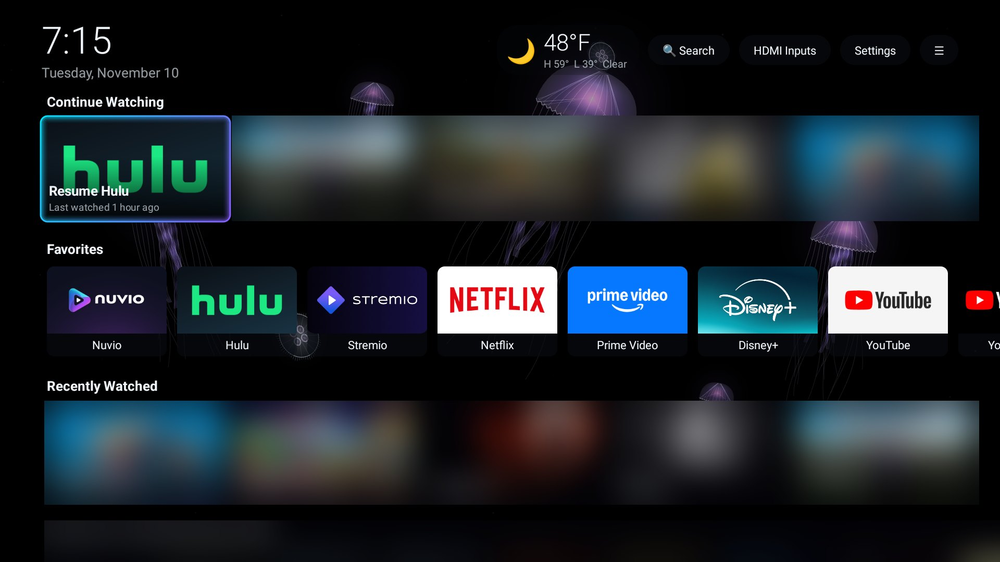
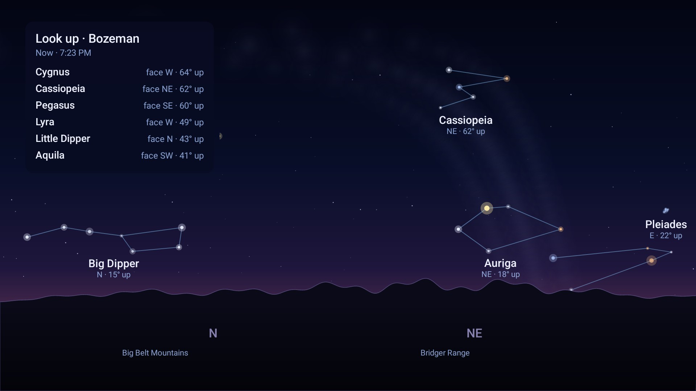
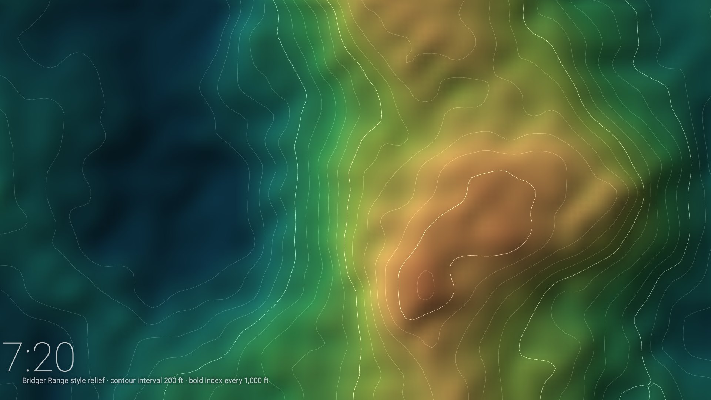
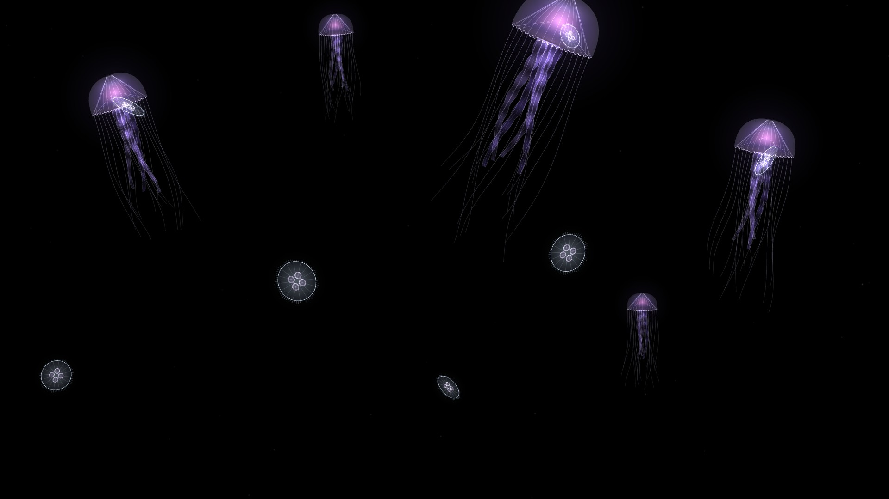
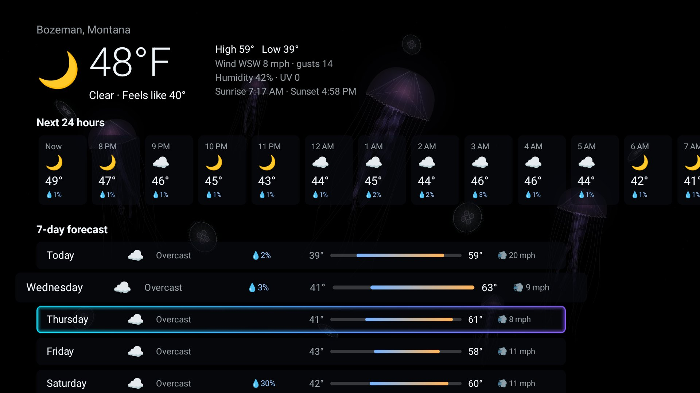
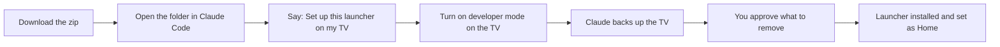

<div align="center">

# 🪼 Custom Google TV Launcher

**An ad-free home screen for Google TV and Android TV, with a live jellyfish background, local weather,
Continue Watching, and a screensaver that shows you which stars to look for tonight.**

[](#requirements)
[](launcher/)
[](#features)
[](#setup-with-claude-easiest)
[](https://github.com/P0RT3R7/custom-google-tv-launcher/releases/latest)



<sub>Home screen. The watch-history rows are blurred in this screenshot.</sub>

</div>

## Features

| | |
|---|---|
| 🪼 **Live background** | Glowing sea nettles and moon jellies drawn in OpenGL at 60 fps, or your own video |
| 📺 **Continue Watching** | Resume cards for apps like Hulu, plus episode-level progress from Trakt and apps that share it |
| 🎬 **Recently Watched + suggestions** | "Because you watched…" rows built from your history, opening straight into Nuvio or Stremio |
| ⭐ **Favorites, recent apps, All Apps** | Long-press any tile to reorder, pin or hide |
| 🌤 **Weather** | Current conditions in the top bar; full screen with 24-hour and 7-day forecast and NWS alerts |
| 🔎 **Search with voice** | Apps, movies and shows in one place |
| 🎵 **Now Playing bar** | Shows what's playing in the background |
| 🌙 **Night mode** | A warm, dim filter from 8:30 PM to 5 AM so the screen is easy on your eyes |
| 🔌 **HDMI inputs + Settings** | One click from the top bar |

## Screensavers



**Night Sky.** The real sky over your location, right now, slowly turning around the horizon. The panel lists the best
constellations to go outside and find, with the direction to face and how high to look. During the day it shows tonight's sky.

<table>
<tr>
<td width="50%"></td>
<td width="50%"></td>
</tr>
<tr>
<td><b>Topo Glow.</b> A colored relief map with hillshading and glowing contour lines that drifts slowly north.</td>
<td><b>Jellyfish Deep.</b> Sea nettles and moon jellies drifting through dark water.</td>
</tr>
</table>

Pick one with ☰ → Screensaver theme, or let them rotate.

## Weather



Open it from the top bar: conditions now, the next 24 hours, 7 days, sunrise and sunset, and active alerts.

## Setup with Claude (easiest)



1. Download **hisense-tv-launcher.zip** from the [latest release](https://github.com/P0RT3R7/custom-google-tv-launcher/releases/latest) and unzip it on a PC on the same Wi-Fi as the TV.
2. Open the folder in **Claude Code** (desktop app: Code tab → choose the folder) and say **"Set up this launcher on my TV."**
3. Claude follows [`CLAUDE.md`](CLAUDE.md). It walks you through developer mode, makes a backup first, and asks before every change.

## Manual setup

```bash
adb connect <TV_IP>:5555
adb install -r custom-tv-launcher.apk
P=com.custom.hisenselauncher
adb shell appops set $P GET_USAGE_STATS allow
adb shell cmd notification allow_listener $P/$P.media.MediaListenerService
adb shell settings put secure screensaver_components $P/$P.dream.JellyDreamService
adb shell cmd package set-home-activity $P/.MainActivity
```

On Google TV you'll also need to disable the stock launcher so Home opens this one; see [`CLAUDE.md`](CLAUDE.md) for the
safe way to do that and how to undo it.

**Settings from the PC** (no remote needed):

```bash
adb shell am broadcast -n com.custom.hisenselauncher/.ConfigReceiver --es screensaver_theme NIGHT_SKY   # ROTATE | NIGHT_SKY | TOPO | JELLYFISH
adb shell am broadcast -n com.custom.hisenselauncher/.ConfigReceiver --es night_mode AUTO              # AUTO | ON | OFF
adb shell am broadcast -n com.custom.hisenselauncher/.ConfigReceiver --es set_place "Denver, Colorado" --ef lat 39.7392 --ef lon -104.9903
```

## Requirements

- Google TV or Android TV, Android 8.0+ (built and tested on a Hisense Google TV, Android 12)
- A PC with [adb](https://developer.android.com/tools/releases/platform-tools) on the same network
- Optional: a free [Trakt](https://trakt.tv) account for episode-level Continue Watching and recommendations
- To build from source: JDK 17 and Android SDK 34 (see [`launcher/README.md`](launcher/README.md))

## Undo

```bash
bash tv-tools/restore.sh <TV_IP>
```

This brings back the stock Google TV home screen, re-enables everything that was disabled, and restores the original settings.
